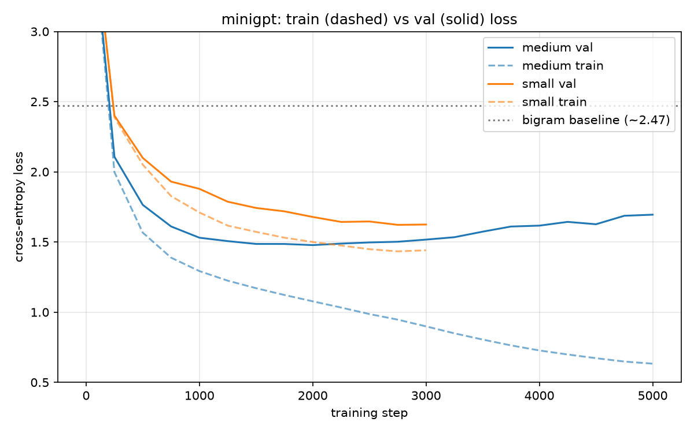

# minigpt

A small GPT-style language model built from scratch in PyTorch and trained on TinyShakespeare. I built it over four days to understand how LLMs work, from tokenizer to attention to training dynamics, and documented what the experiments showed.

The approach follows Andrej Karpathy's *"Let's build GPT: from scratch, in code"* and the nanoGPT project, with my own experiments on top: a bits-per-character comparison between tokenizers, an overfitting study, and a from-scratch BPE implementation.



## Results

| Model | Parameters | Best val loss | Val bits/char |
|---|---|---|---|
| Random guessing | n/a | 4.17 | 6.02 |
| Bigram baseline (`bigram.py`) | 4,225 | about 2.48 | 3.58 |
| Small GPT, character-level | 824,320 | 1.622 | 2.34 |
| Medium GPT, character-level | 10,786,560 | **1.478** (step 2000) | **2.13** |
| Small GPT, BPE (vocab 512) | TBD | TBD | TBD |

<!-- Fill the BPE row from log_small_bpe.csv: "val" column is the loss, "val_bpc" is bits/char. Use the best (lowest) row. Parameter count is printed at the start of training. -->

Loss is per token, so models with different tokenizers are compared on **bits per character** (bpc), which converts both to the same unit.

### Key findings

1. **Attention matters a lot.** The bigram model sees one character of context and stalls at a loss of about 2.48. The small GPT, which sees up to 128 characters, reaches 1.62 in about a minute of training.
2. **The bigger model overfit.** The 10.8M-parameter model hit its best validation loss at step 2000 (1.478). After that, training loss kept falling to 0.63 while validation loss rose to 1.69, which is worse than the small model. A model with about ten parameters per training character memorizes the dataset. I keep the best-validation checkpoint, not the final one.
3. **Fitting a bigger model on a small GPU.** My laptop GPU has about 4 GB, and the medium model ran out of memory at batch size 64. Gradient accumulation (4 micro-batches of 16, summed before each optimizer step) gives the same effective batch with a quarter of the memory.
4. **Tokenizers need a fair metric.** BPE averages 2.22 characters per token, so its per-token loss isn't comparable to a character model's. Converting to bits per character makes the comparison valid.

## Samples

Small GPT, character-level (`--prompt "ROMEO:" --temp 0.7 --top_k 20`):

```
ROMEO:
All before with a purpose be made the way age.
Stirrah, what have been thee should them comest
Have away with himself my lord
```

The model has learned the shape of a play: speaker names, line breaks, verse-length lines, and mostly real words. It has not learned meaning, which is expected at this scale.

## Project layout

| File | What it does |
|---|---|
| `prepare.py` | Downloads TinyShakespeare, builds a character tokenizer, writes train/val splits |
| `bigram.py` | Batching and the simplest possible language model, used as a baseline |
| `attention_demo.py` | Prints causal averaging, softmax masking and one self-attention head step by step |
| `gpt.py` | Decoder-only transformer (multi-head attention, MLP, residuals, LayerNorm) and training loop, with `small` and `medium` presets |
| `bpe.py` | Byte-pair encoding written from scratch: training, encoding, vocabulary building |
| `prepare_bpe.py` | Learns BPE merges on the training split only and writes the BPE data files |
| `sample.py` | Generates text from a saved checkpoint with temperature, top-k and a custom prompt |
| `plot_losses.py` | Plots train/val loss and validation bits-per-character for every logged run |

## Run it

```bash
pip install torch numpy matplotlib

python prepare.py                       # downloads data, writes train.bin / val.bin / meta.pkl
python bigram.py                        # baseline, loss about 2.5
python gpt.py                           # small GPT, about 1 minute on a GPU
MINIGPT_SIZE=medium python gpt.py       # 10.8M parameters, about 50 minutes on a 4 GB laptop GPU

python prepare_bpe.py                   # train the BPE tokenizer (about 40 seconds)
MINIGPT_TOK=bpe python gpt.py           # small GPT with BPE tokens

python plot_losses.py                   # writes loss_curves.png and bpc_curves.png
python sample.py --prompt "ROMEO:" --temp 0.7 --top_k 20 --n 600
MINIGPT_SIZE=medium python sample.py    # sample from the medium checkpoint
```

`gpt.py` uses CUDA when available and falls back to CPU. Environment variables select the preset (`MINIGPT_SIZE=small|medium|medium_reg`) and tokenizer (`MINIGPT_TOK=char|bpe`). Each combination writes its own checkpoint and loss log, so runs never overwrite each other. Checkpoints (`*.pt`) are not committed to the repo.

## Limitations

- The dataset is about 1 million characters, so anything over a few million parameters overfits quickly.
- Evaluation is validation loss and bits per character only. I did not run downstream benchmarks.
- This is a learning project, not a chatbot. It writes text that looks like Shakespeare and does not follow instructions.

## Next steps

- Train on a larger corpus (TinyStories) to see whether the medium model's overfitting goes away.
- Test the included `medium_reg` preset (dropout 0.3, 2500 steps) against the first medium run.
- Add modern components: RoPE, RMSNorm, SwiGLU.